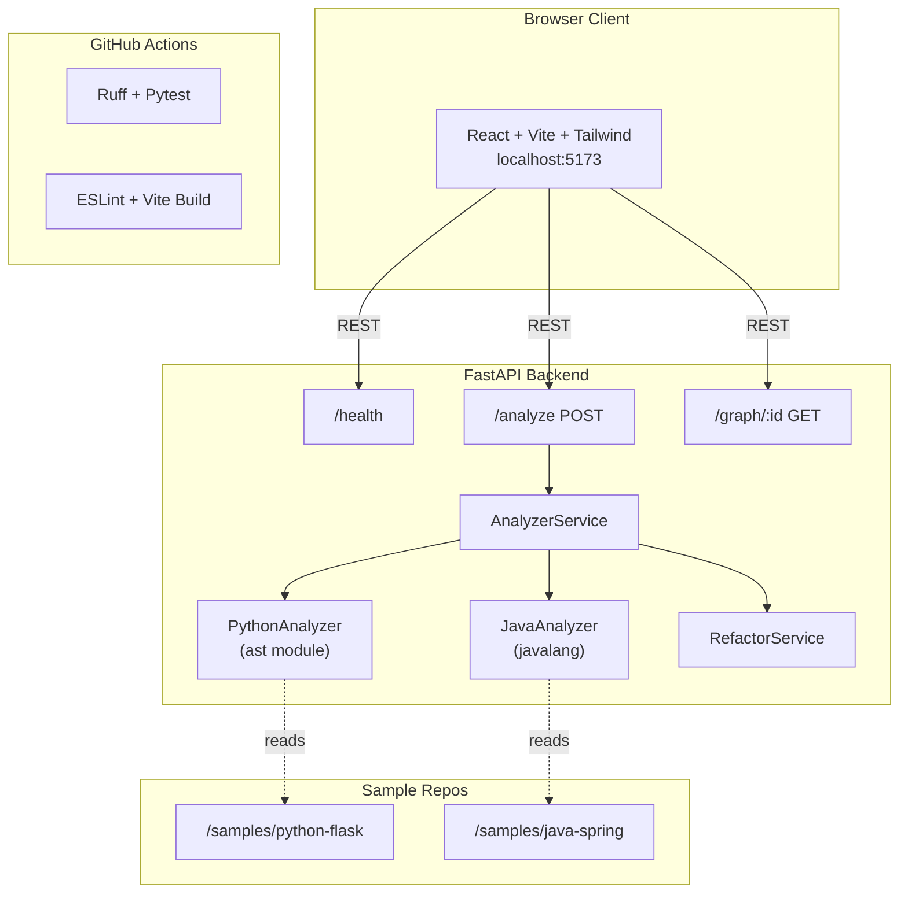

# ArchLens 🔭

**Automated Codebase Architecture Visualizer & Refactoring Engine**

ArchLens statically analyses multi-language codebases (Python & Java), generates interactive dependency graphs, detects architectural smells, and surfaces actionable refactoring suggestions — all through a modern web UI.

---

## Architecture



---

## Quick Start

### Prerequisites

| Tool | Version |
|------|---------|
| Python | ≥ 3.12 |
| Node.js | ≥ 20 |
| make | (Windows: via Git Bash or choco install make) |
| git | any |

### 1 — Clone & configure

```bash
git clone <repo-url> archlens
cd archlens
cp .env.example .env          # adjust if needed
cp backend/.env.example backend/.env
```

### 2 — Install dependencies

```bash
make install
```

### 3 — Start dev servers

```bash
make dev
```

This opens two terminal windows:
- **Backend** → http://localhost:8000 (FastAPI + auto-reload)
- **Frontend** → http://localhost:5173 (Vite HMR)

### 4 — Verify health

```bash
curl http://localhost:8000/health
# {"status":"ok","version":"0.1.0"}
```

---

## Project Structure

```
archlens/
├── backend/          FastAPI application & analyzers
│   ├── app/
│   │   ├── api/      Route handlers (health, analyze, graph)
│   │   ├── analyzers/ Python & Java static analyzers
│   │   ├── core/     Config, logging
│   │   ├── models/   Pydantic models
│   │   └── services/ Business logic
│   └── tests/        pytest test suite
├── frontend/         React + Vite + TypeScript + Tailwind
│   └── src/
│       ├── api/      Axios API client
│       ├── components/ GraphCanvas, AnalyzePanel, SmellList
│       ├── hooks/    useAnalysis custom hook
│       └── types/    Shared TypeScript types
├── samples/
│   ├── java-spring/  spring-petclinic (shallow clone)
│   └── python-flask/ pallets/flask (shallow clone)
├── docs/             Architecture & API reference
├── .github/workflows/ GitHub Actions CI
└── Makefile
```

---

## Available Commands

| Command | Description |
|---------|-------------|
| `make install` | Install all backend + frontend deps |
| `make dev` | Start both servers (two terminals) |
| `make dev-backend` | Start only FastAPI |
| `make dev-frontend` | Start only Vite |
| `make test` | Run pytest with coverage |
| `make lint` | Run ruff + eslint |
| `make clean` | Remove build artifacts |

---

## API Reference

### `GET /health`

```json
{ "status": "ok", "version": "0.1.0" }
```

### `POST /analyze`

**Request**
```json
{
  "path": "./samples/python-flask",
  "language": "auto"
}
```

**Response**
```json
{
  "repo_id": "3fa85f64-5717-4562-b3fc-2c963f66afa6",
  "language": "python",
  "node_count": 24,
  "edge_count": 51,
  "smells": [
    {
      "type": "god_module",
      "file": "src/flask/app.py",
      "severity": "high",
      "description": "Module has 2000+ lines; consider splitting."
    }
  ],
  "graph": {
    "nodes": [{ "id": "flask.app", "label": "app", "type": "module" }],
    "edges": [{ "source": "flask.app", "target": "flask.ctx" }]
  }
}
```

### `GET /graph/{repo_id}`

Returns previously computed graph by UUID.

---

## Linting & Tests

```bash
make lint   # ruff + eslint
make test   # pytest --cov
```

---

## CI / CD

GitHub Actions runs on every push and pull request:

- **backend job**: ruff lint → pytest
- **frontend job**: eslint → vite build

See [`.github/workflows/ci.yml`](.github/workflows/ci.yml).

---

## Tech Stack

| Layer | Technology |
|-------|-----------|
| Backend | FastAPI 0.111, Python 3.12, uvicorn |
| Linting (Py) | ruff |
| Testing | pytest, httpx, pytest-cov |
| Frontend | React 18, Vite 5, TypeScript 5, Tailwind CSS 3 |
| Graph UI | React Flow v11 |
| Java parsing | javalang |
| Python parsing | ast (stdlib) |
| CI | GitHub Actions |

---

## Security & Secrets Management

All production secrets are managed exclusively through application `Settings` configured via environment variables.

### Admin Provisioning Key Rotation & Compromise Notice

> [!WARNING]
> **Key Compromise & Deprecation Notice**: Legacy development keys (`ARCHLENS-ADMIN-SEC-2026`, `ARCHLENS-ROOT-KEY`, `SEC-ADMIN-99`) have been permanently removed from the codebase and are deemed compromised.

- Admin account provisioning requires the environment variable `ARCHLENS_ADMIN_PROVISION_KEY`.
- If `ARCHLENS_ADMIN_PROVISION_KEY` is not set or empty, public administrator registration is disabled by default (returns `403 Forbidden`).
- To enable or rotate the administrator provisioning key, set a cryptographically secure value in your environment or `.env` file:
  ```bash
  export ARCHLENS_ADMIN_PROVISION_KEY="your-high-entropy-secret-key-here"
  ```

---

## License

MIT
