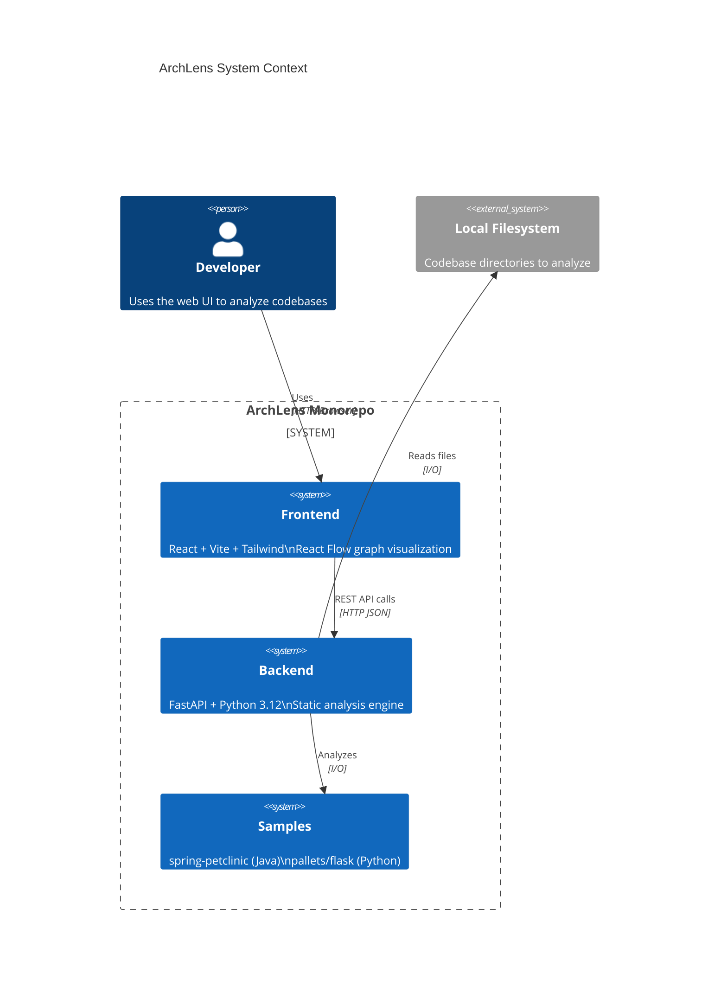
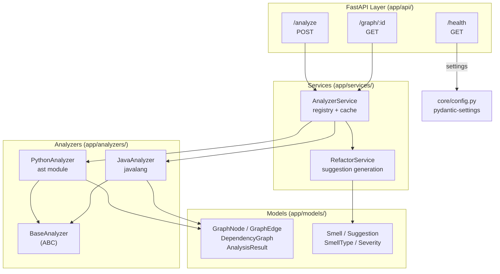
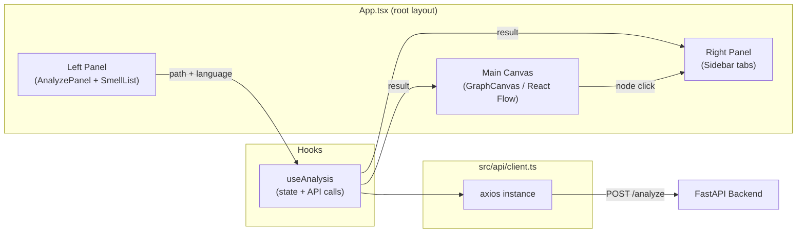
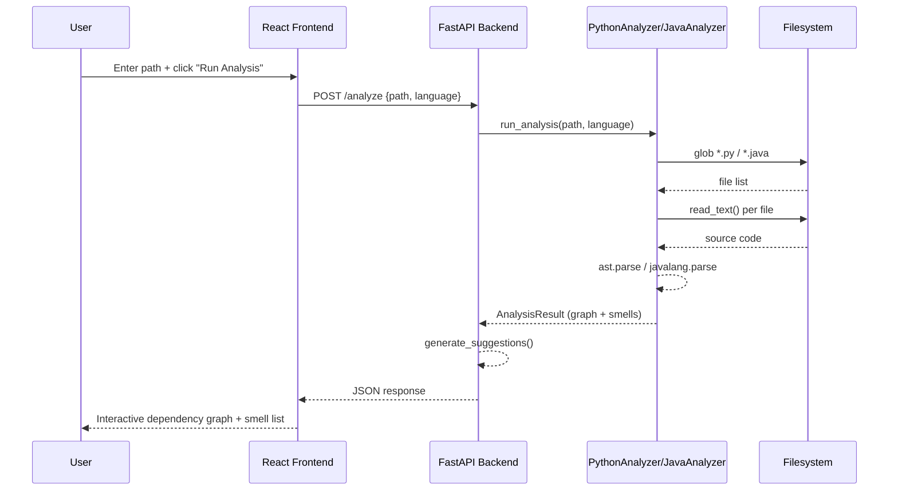
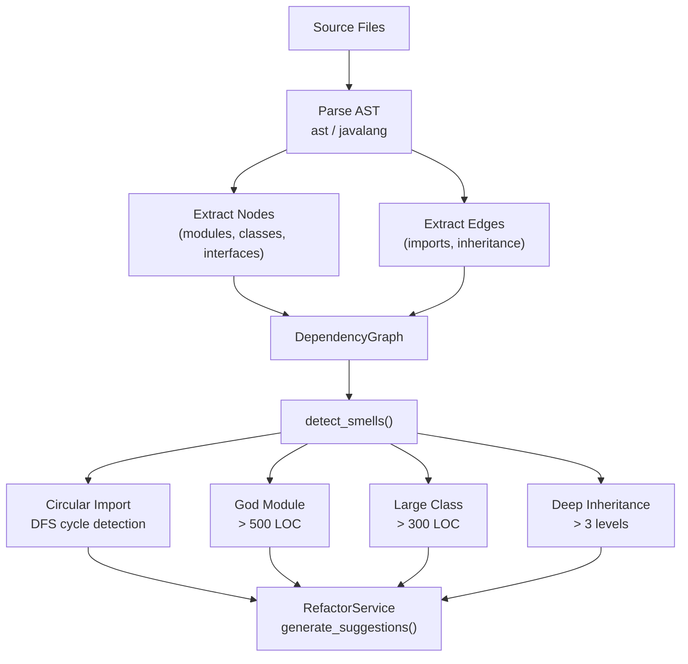

# ArchLens Architecture

## System Overview

ArchLens is a monorepo containing a FastAPI backend (Python 3.12+) and a React+Vite frontend, designed to provide static codebase analysis through a rich web interface.

---

## Component Diagram



---

## Backend Architecture



---

## Frontend Architecture



---

## Data Flow: Analysis Request



---

## Smell Detection Pipeline



---

## Directory Structure

```
archlens/
├── backend/              FastAPI application
│   ├── app/
│   │   ├── api/          Route handlers
│   │   ├── analyzers/    Language-specific analyzers
│   │   ├── core/         Config + logging
│   │   ├── models/       Pydantic models
│   │   └── services/     Business logic
│   └── tests/            pytest test suite
├── frontend/             React + Vite + TypeScript
│   └── src/
│       ├── api/          Axios client
│       ├── components/   UI components
│       ├── hooks/        Custom React hooks
│       └── types/        TypeScript type definitions
├── samples/              Demo repos (shallow clones)
│   ├── java-spring/      spring-petclinic
│   └── python-flask/     pallets/flask
├── docs/                 Documentation
├── .github/workflows/    CI pipeline
└── Makefile             Development commands
```

---

## Key Design Decisions

| Decision | Choice | Rationale |
|----------|--------|-----------|
| Python analysis | `ast` stdlib | Zero extra deps, handles Python 3.x syntax |
| Java analysis | `javalang` | Pure-Python, no JVM required |
| Graph storage | In-process dict | Simple for single-instance deployment; swap Redis for distributed |
| API style | REST | Simple, cacheable, easy to test with curl |
| Frontend graph | React Flow | Production-grade, supports interactive pan/zoom/minimap |
| Env config | pydantic-settings | Type-safe, env-var + .env file support, validator support |
